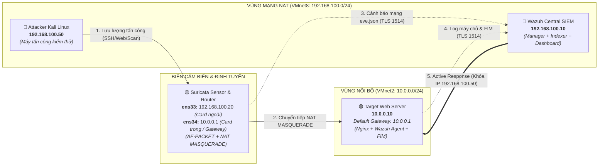
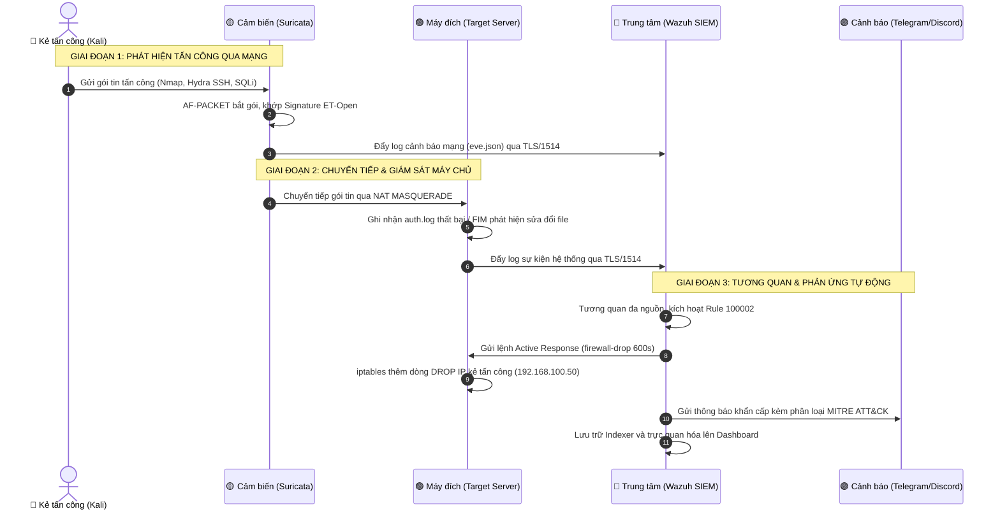

# HỆ THỐNG GIÁM SÁT AN NINH MẠNG TẬP TRUNG (SOC LAB)
## KẾT HỢP CENTRAL SIEM (WAZUH) VÀ NIDS/IPS (SURICATA) VỚI PHẢN ỨNG TỰ ĐỘNG

[](https://github.com/Team16S/soc-lab-wazuh-suricata/actions/workflows/ci.yml)


> **Mô tả hệ thống:** Trung tâm điều hành an ninh mạng thu nhỏ xây dựng trên VMware Workstation, kết hợp động cơ phân tích gói tin mạng Suricata (NIDS/IPS) với nền tảng quản lý sự kiện thông tin an ninh Wazuh (SIEM) để giám sát đa tầng và tự động ngăn chặn địa chỉ IP tấn công theo thời gian thực.  
> **Cơ cấu nhóm:** 03 thành viên | **Tài liệu thi công chi tiết:** [`docs/Ke_Hoach_Trien_Khai.md`](docs/Ke_Hoach_Trien_Khai.md) | **Báo cáo đồ án:** [`docs/Bao_Cao_Do_An_An_Ninh_Mang.md`](docs/Bao_Cao_Do_An_An_Ninh_Mang.md)

---

## 1. QUY TRÌNH ĐỒNG BỘ GIT & BẮT ĐẦU PHIÊN LÀM VIỆC

Mọi thành viên bắt buộc cập nhật nhánh `main` trước khi thực hiện bất kỳ thao tác kỹ thuật nào:

```bash
# 1. BẮT BUỘC: Luôn kéo mã nguồn mới nhất từ main trước khi làm việc:
git switch main && git pull --ff-only origin main

# 2. Đồng bộ cập nhật từ main vào nhánh tính năng cá nhân đang phát triển:
git stash && git switch main && git pull origin main && git switch <nhanh-cua-ban> && git merge main && git stash pop

# 3. Kéo nhánh Pull Request của đồng đội về máy để kiểm tra chéo (Review PR):
git fetch origin && git switch --track origin/<ten-nhanh-pr>
```

---

## 2. NGUYÊN TẮC LÀM VIỆC & PHỐI HỢP TRỢ LÝ AI (AI GOVERNANCE)

* **Quyền quyết định thuộc về con người (Human Approval Gate):** AI chỉ đóng vai trò tư vấn kỹ thuật và rà soát lỗi cú pháp. Nghiêm cấm chạy lệnh `git commit` hoặc `git push` nếu chưa có sự đồng ý trực tiếp của thành viên.
* **Chính sách không lộ lọt dữ liệu (Zero-Leak Policy):** Tuyệt đối không commit Private Key, Telegram/Discord Token thật, file mật khẩu `wazuh-passwords.txt`, tệp log lớn `eve.json` hoặc ổ đĩa ảo `.vmdk`.
* **Lưu vết phiên làm việc (Session Persistence):** Sau mỗi phiên làm việc, thành viên yêu cầu AI cập nhật tóm tắt mốc kỹ thuật vào `session_summary.md` trên máy cá nhân để duy trì ngữ cảnh cho các phiên tiếp theo.
* **Quy chuẩn đối soát QA:** Thực hiện đối soát bắt buộc theo quy tắc [.agent/rules/qa-soc-lab-protocol.md](.agent/rules/qa-soc-lab-protocol.md) trước và sau mỗi tác vụ kỹ thuật.

---

## 3. PHÂN CÔNG TRÁCH NHIỆM 3 THÀNH VIÊN (RACI MATRIX)

| Thành viên | Vai trò đảm nhiệm | Node máy ảo phụ trách | Nhiệm vụ kỹ thuật trọng tâm | Hướng dẫn thi công chi tiết |
| :---: | :--- | :--- | :--- | :---: |
| **Thành viên 1** | SIEM & Integration Lead | `Wazuh-SIEM`<br>(`192.168.100.10`) | Cài đặt OVA, gán IP tĩnh, hạ tải JVM Indexer xuống 1GB, thiết lập Whitelist và Active Response `firewall-drop`, viết rule tương quan 100002, tích hợp Webhook Discord/Telegram. | [Xem Runbook TV1](docs/Ke_Hoach_Trien_Khai.md#runbook-tv1) |
| **Thành viên 2** | Network & Sensor Specialist | `Suricata-Sensor`<br>(`192.168.100.20` & `10.0.0.1`) | Cấu hình Netplan 2 card, bật IP Forwarding và NAT MASQUERADE qua `iptables-persistent`, cài đặt Suricata 7.x, biên soạn `local.rules`, cấu hình Wazuh Agent đọc luồng `eve.json`. | [Xem Runbook TV2](docs/Ke_Hoach_Trien_Khai.md#runbook-tv2) |
| **Thành viên 3** | Target Admin & Red Team Lead | `Target-Server` (`10.0.0.10`) & `Attacker-Kali` (`192.168.100.50`) | Cấu hình Target Server trỏ Gateway về Sensor, cài Nginx và Agent FIM `/var/www/html/`; cấu hình Static route trên Kali, giải nén từ điển `rockyou.txt`, thực thi 4 kịch bản tấn công. | [Xem Runbook TV3](docs/Ke_Hoach_Trien_Khai.md#runbook-tv3) |

---

## 4. LỆNH VẬN HÀNH NHANH & CỨU HỘ KHẨN CẤP (QUICK CLI)

### 4.1. Bảng lệnh SSH từ PowerShell máy thật Windows vào 4 máy ảo
Thay vì gõ lệnh trên màn hình console VMware, mở PowerShell trên Windows và kết nối trực tiếp:
| Máy ảo | Địa chỉ IP | Lệnh SSH từ PowerShell máy thật | Mật khẩu mẫu phòng lab |
| :--- | :--- | :--- | :--- |
| **Wazuh-SIEM** | `192.168.100.10` | `ssh wazuh-user@192.168.100.10` | `wazuh` *(Mặc định OVA)* |
| **Suricata-Sensor** | `192.168.100.20` | `ssh ubuntu@192.168.100.20` | `123` *(Mật khẩu lab nội bộ)* |
| **Target-Server** | `10.0.0.10` | `ssh ubuntu@10.0.0.10` *(chạy lệnh route Windows bên dưới)* | `123` *(Mật khẩu lab nội bộ)* |
| **Attacker-Kali** | `192.168.100.50` | `ssh kali@192.168.100.50` | `kali` *(Mặc định Kali Linux)* |

*(Lưu ý cho Target: Mở PowerShell Admin trên máy thật gõ lệnh định tuyến một lần: `route add 10.0.0.0 mask 255.255.255.0 192.168.100.20` để máy thật kết nối thẳng vào Target qua Sensor).*

### 4.2. Bộ lệnh kiểm tra nhanh & Cứu hộ khẩn cấp
```bash
# 1. Kiểm tra trạng thái dịch vụ trung tâm trên Wazuh SIEM:
sudo systemctl status wazuh-manager wazuh-indexer wazuh-dashboard

# 2. Kiểm tra trạng thái cảm biến Suricata và Wazuh Agent trên Sensor:
sudo systemctl status suricata wazuh-agent

# 3. Xem luồng log cảnh báo Suricata trực tiếp theo thời gian thực:
tail -f /var/log/suricata/eve.json | jq 'select(.event_type=="alert") | {time: .timestamp, src: .src_ip, alert: .alert.signature}'

# 4. Kiểm tra danh sách địa chỉ IP đang bị khóa trên Target Server:
sudo iptables -L INPUT -n -v --line-numbers

# 5. Xóa chặn khẩn cấp toàn bộ iptables (khi bị tự khóa nhầm):
sudo iptables -F
```

---

## 5. LƯU Ý KỶ LUẬT SNAPSHOT & BẢO TOÀN HIỆN TRƯỜNG MÁY ẢO

* **Chụp Snapshot ở phiên cuối của Task:** Không cần chụp lắt nhắt ở từng lệnh nhỏ. Chỉ chụp Snapshot khi đã hoàn thành trọn vẹn một task nhiệm vụ lớn của thành viên (đã cấu hình xong IP tĩnh, dựng xong dịch vụ, hoặc kết nối thành công Agent về SIEM).
* **Chụp Snapshot ngay trước khi tắt máy (`sudo poweroff`):** Khi kết thúc phiên làm việc, luôn chụp Snapshot trước khi tắt máy ảo. Không tắt máy ngang hoặc để máy tắt hoàn toàn khi chưa lưu mốc checkpoint.
* **Bảo toàn hiện trường khi gặp sự cố:** Nếu phát sinh lỗi kết nối mạng, dịch vụ bị treo hoặc cấu hình iptables bị sai, chụp ngay một Snapshot trạng thái lỗi để giữ nguyên hiện trường phục vụ tra cứu log (`journalctl -xe`, `ossec.log`). Không tắt nguồn cưỡng bức (hard reset) để tránh làm hỏng cơ sở dữ liệu Indexer.
* **Khôi phục nhanh:** Khi cấu hình bị lỗi không khắc phục được, hoàn tác về Snapshot checkpoint gần nhất trong vài giây thay vì phải cài lại máy từ đầu.

---

## 6. MA TRẬN KIỂM THỬ THỰC NGHIỆM & KẾT QUẢ ĐO LƯỜNG (MITRE ATT&CK)

### 6.1. Bảng 4 kịch bản kiểm thử tấn công - phòng thủ
| Mã | Kịch bản tấn công | Lệnh thực thi từ Kali | Khung MITRE ATT&CK | Cơ chế phát hiện | Cơ chế phản ứng (Active Response) | Bằng chứng nghiệm thu |
| :---: | :--- | :--- | :---: | :--- | :--- | :--- |
| **TC-01** | Quét cổng mạng do thám | `nmap -sS -p 22,80 10.0.0.10` | **T1046** (Network Service Discovery)<br>**T1595** (Active Scanning) | Suricata bắt signature Nmap trong `eve.json` | Wazuh SIEM nhận log, sinh Alert Level 6 | Dashboard ghi nhận sự kiện; IP chưa bị chặn |
| **TC-02** | Dò quét mật khẩu SSH | `hydra -l ubuntu -P ~/test_pass.txt ssh://10.0.0.10 -t 4` | **T1110.001** (Brute Force: Password Guessing) | Wazuh Agent đọc `/var/log/auth.log` failed 5 lần liên tiếp | **Rule 100002 (Level 10)** kích hoạt `firewall-drop` trên Target | Hydra báo timed out; `iptables -L` có dòng DROP IP Kali; Webhook nhận tin |
| **TC-03** | Khai thác Web SQL Injection | `curl -G "http://10.0.0.10/" --data-urlencode "id=1' UNION SELECT..."` | **T1190** (Exploit Public-Facing Application) | Suricata bắt signature SQLi chuỗi `UNION` | Kích hoạt cảnh báo Critical (Level 10+) | Suricata ghi alert; Webhook gửi cảnh báo màu đỏ tức thời |
| **TC-04** | Tải WebShell & Giám sát FIM | `echo "<?php system(\$_GET['cmd']); ?>" > /var/www/html/shell.php` | **T1505.003** (Server Component: Web Shell) | Wazuh FIM (`syscheck`) dùng `inotify` quét real-time `/var/www/html/` | Kích hoạt Rule 554 (File added) và Rule 550 (Checksum changed) | Dashboard hiển thị file bị thêm/sửa, diff nội dung tệp; Webhook báo động |

### 6.2. Chỉ số đo lường hiệu năng thực nghiệm (KPIs & Metrics)
| Chỉ số đo lường (Metric) | Tiêu chuẩn cam kết (SLA) | Kết quả thực nghiệm lab | Đánh giá |
| :--- | :---: | :---: | :---: |
| **Thời gian phát hiện gói tin độc hại (Detection Latency)** | $< 2.0$ giây | **$\approx 0.8$ giây** | Đạt chuẩn |
| **Thời gian tương quan log về SIEM (SIEM Ingestion Latency)** | $< 3.0$ giây | **$\approx 1.5$ giây** | Đạt chuẩn |
| **Thời gian kích hoạt chặn IP tường lửa (Active Response Latency)** | $< 3.0$ giây | **$\approx 1.2$ giây** | Đạt chuẩn |
| **Thời gian đẩy thông báo khẩn qua Webhook** | $< 5.0$ giây | **$\approx 2.1$ giây** | Đạt chuẩn |
| **Mức tiêu hao tài nguyên phần cứng (Resource Consumption)** | RAM $< 11\text{GB}$ | **$\approx 9.5\text{GB}$ RAM** (toàn bộ 4 máy ảo) | Vận hành mượt mà |

---

## 7. QUY HOẠCH HẠ TẦNG & THÔNG SỐ IP TĨNH

### 7.1. Khóa cứng phiên bản phần mềm & Liên kết tải trực tiếp
> ⛔ **Cảnh báo tính tương thích:**
> * **Wazuh SIEM:** Bắt buộc dùng bản **4.8.0** hoặc **4.7.5**. Không dùng bản 4.14+ do thay đổi kiến trúc Indexer và lược bỏ script trích xuất mật khẩu.
> * **Ubuntu Server:** Bắt buộc dùng bản **22.04.5 LTS**. Không dùng bản Ubuntu 24.04 LTS (khai tử cú pháp Netplan `gateway4`, chặn cài Python qua lỗi PEP 668).

| Thành phần | Phiên bản chuẩn | Tên tệp & Liên kết tải chính thức | Hệ điều hành nền tảng |
| :--- | :---: | :--- | :--- |
| **Wazuh-SIEM** | **4.8.0** / 4.7.5 | • Bản 4.8: [`wazuh-4.8.0.ova` (Tải trực tiếp)](https://packages.wazuh.com/4.x/vm/wazuh-4.8.0.ova) — [Tài liệu Wazuh 4.8](https://documentation.wazuh.com/4.8/deployment-options/virtual-machine/virtual-machine.html)<br>• Bản 4.7: [`wazuh-4.7.5.ova` (Tải trực tiếp)](https://packages.wazuh.com/4.x/vm/wazuh-4.7.5.ova) — [Tài liệu Wazuh 4.7](https://documentation.wazuh.com/4.7/deployment-options/virtual-machine/virtual-machine.html) | Amazon Linux 2023 minimal |
| **Sensor & Target** | **22.04.5 LTS** | [`ubuntu-22.04.5-live-server-amd64.iso` (Tải trực tiếp)](https://releases.ubuntu.com/jammy/ubuntu-22.04.5-live-server-amd64.iso) | Ubuntu Server 64-bit |
| **Attacker-Kali** | **2024.x** | [Kali Linux VMware Pre-built (.7z)](https://www.kali.org/get-kali/#kali-virtual-machines) | Kali Linux (Debian Core) |
| **Suricata Engine** | **7.0.x Stable** | PPA chính thức: `ppa:oisf/suricata-stable` | Ubuntu Server 64-bit |

### 7.2. Bảng phân bổ thông số mạng 4 Node
| Node mạng | Vai trò | Card mạng VMware | Địa chỉ IP / Subnet | Default Gateway | Cổng dịch vụ lắng nghe | Thông tin xác thực (Lab Demo Credentials) |
| :--- | :--- | :--- | :--- | :--- | :--- | :--- |
| **Wazuh-SIEM** | Central SIEM | VMnet8 (NAT) | `192.168.100.10/24` | `192.168.100.2` | TCP 443 (Dashboard), 1514 (Agent Event), 1515 (Enrollment) | `wazuh-user` / `[Mặc định OVA: wazuh]`<br>Web: `admin` / `[Mặc định OVA: admin]` |
| **Suricata-Sensor** | Router NAT & NIDS/IPS | `ens33`: VMnet8<br>`ens34`: VMnet2 | `192.168.100.20/24`<br>`10.0.0.1/24` | `192.168.100.2`<br>*(ens34 không đặt GW)* | Bắt gói AF-PACKET, Chuyển tiếp NAT MASQUERADE | `ubuntu` / `[Mật khẩu lab: 123]` |
| **Target-Server** | Máy chủ web đích | `ens33`: VMnet2 (Host-only) | `10.0.0.10/24` | `10.0.0.1` | TCP 80 (Nginx), TCP 22 (SSH), Wazuh Agent Service | `ubuntu` / `[Mật khẩu lab: 123]` |
| **Attacker-Kali** | Máy tấn công kiểm thử | `eth0`: VMnet8 (NAT) | `192.168.100.50/24` | `192.168.100.2` | Nmap, Hydra, curl<br>Tuyến tĩnh: `10.0.0.0/24 via 192.168.100.20` | `kali` / `kali` *(Mặc định OS)* |

> [!NOTE]
> **Khuyến nghị an toàn thông tin (NIST SP 800-63B):** Các thông tin đăng nhập trên được thiết lập phục vụ môi trường phòng thí nghiệm cô lập (VMware NAT / Host-Only). Trong môi trường vận hành thực tế (Production), bắt buộc vô hiệu hóa đăng nhập mật khẩu yếu (`PasswordAuthentication no`) và chuyển sang xác thực bằng cặp khóa SSH (SSH Key Pair).

---

## 8. KIẾN TRÚC HỆ THỐNG & DÒNG CHẢY DỮ LIỆU

### 8.1. Sơ đồ phân vùng kiến trúc mạng (Network Topology)


### 8.2. Sơ đồ dòng chảy dữ liệu sự kiện (Event Data Flow Pipeline)


---

## 9. SƠ ĐỒ TÀI LIỆU DỰ ÁN (DOCUMENTATION SITEMAP)

| Tệp tin / Thư mục | Định vị chức năng trong dự án |
| :--- | :--- |
| **[`README.md`](README.md)** | Bản tóm tắt điều hành (Executive Dashboard) và Cẩm nang vận hành nhanh cho nhóm và giảng viên. |
| **[`docs/Ke_Hoach_Trien_Khai.md`](docs/Ke_Hoach_Trien_Khai.md)** | Sổ tay thi công chi tiết 14 mục: Hướng dẫn VMware từng bước, chi tiết lệnh 9.1-9.3, ngân hàng 20 câu hỏi vấn đáp Viva Voce. |
| **[`docs/Bao_Cao_Do_An_An_Ninh_Mang.md`](docs/Bao_Cao_Do_An_An_Ninh_Mang.md)** | Toàn văn báo cáo khoa học đồ án môn học chuẩn cấu trúc học thuật phục vụ nộp bài và chấm điểm. |
| **[`docs/ANTI_HALLUCINATION_TRUTH.md`](docs/ANTI_HALLUCINATION_TRUTH.md)** | Bảng thông số kỹ thuật chuẩn (Ground Truth) và tập luật cấm AI Tone bảo vệ chất lượng văn bản. |
| **`configs/`** | Toàn bộ tệp cấu hình chuẩn: `ossec-manager.conf`, `suricata.yaml`, `netplan-sensor.yaml`, `netplan-target.yaml`. |
| **`rules/`** | Tập luật an ninh tùy biến: `local_rules.xml` (Wazuh Rule 100002), `local.rules` (Suricata Signatures). |
| **`scripts/`** | Kịch bản Webhook Python (`custom-discord.py`, `custom-telegram.py`) và kịch bản tấn công (`attack_simulation.sh`). |
